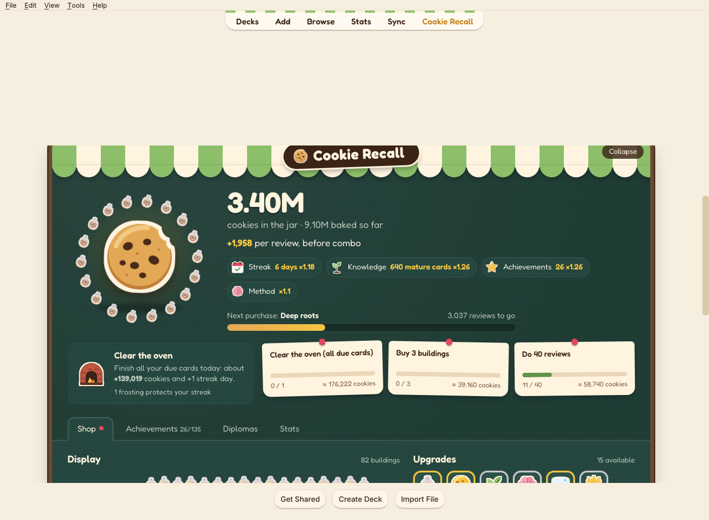
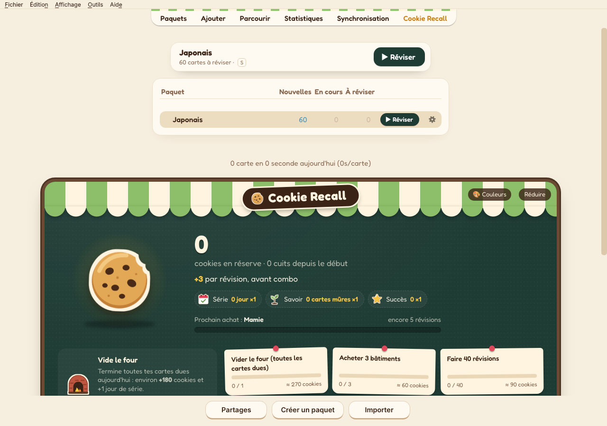
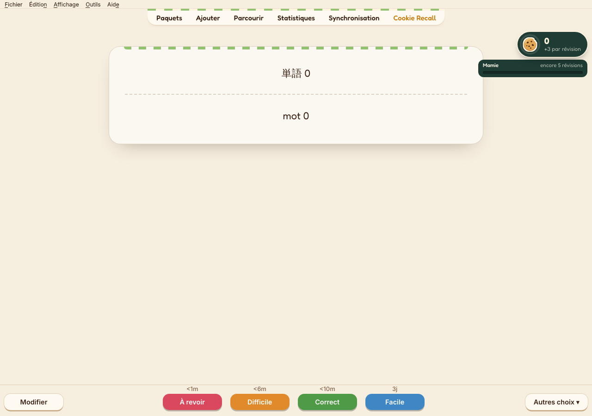
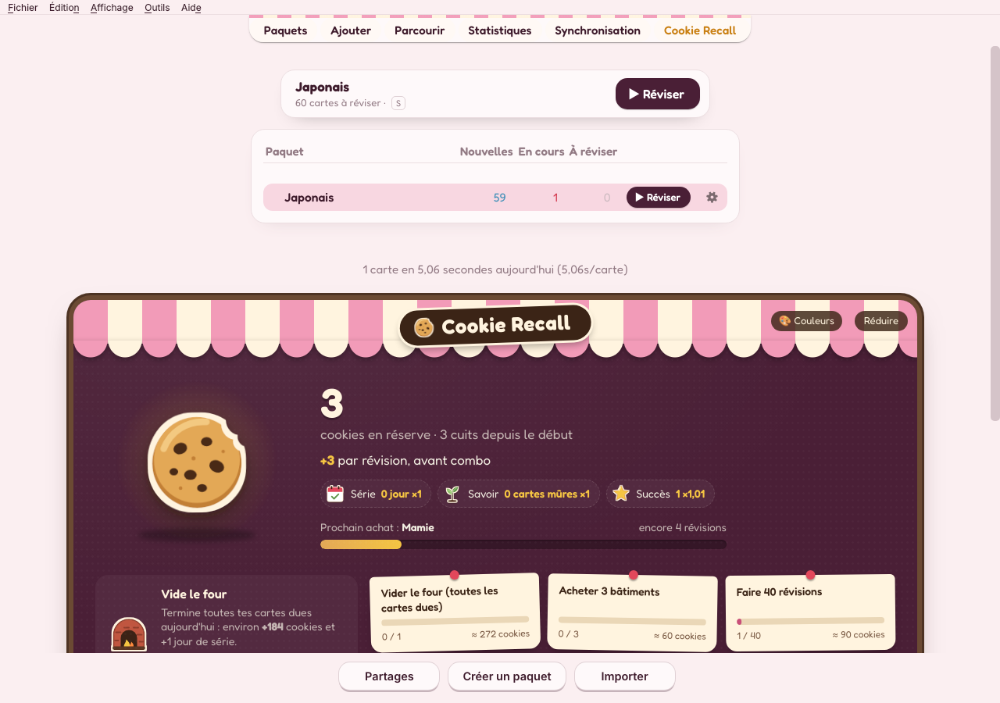
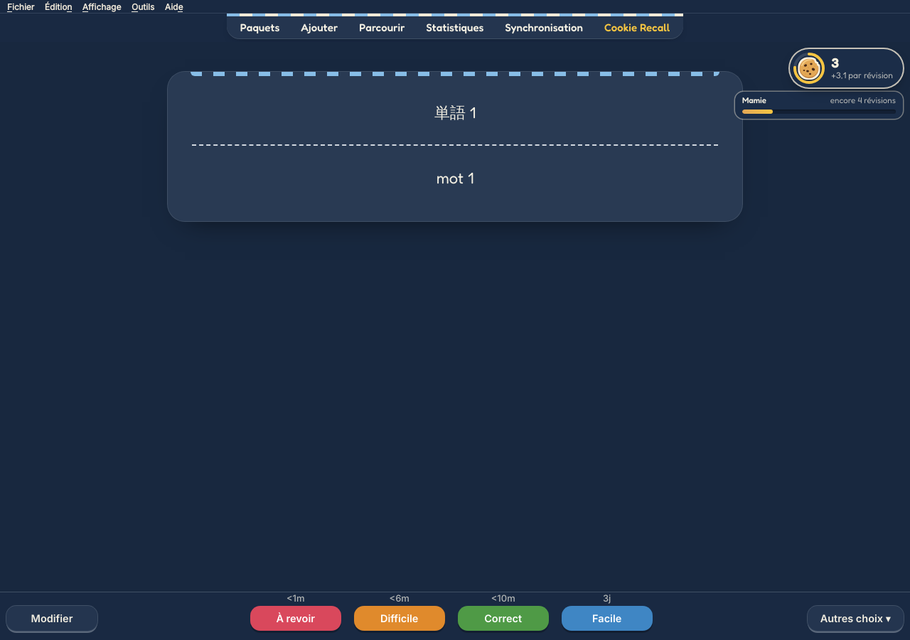
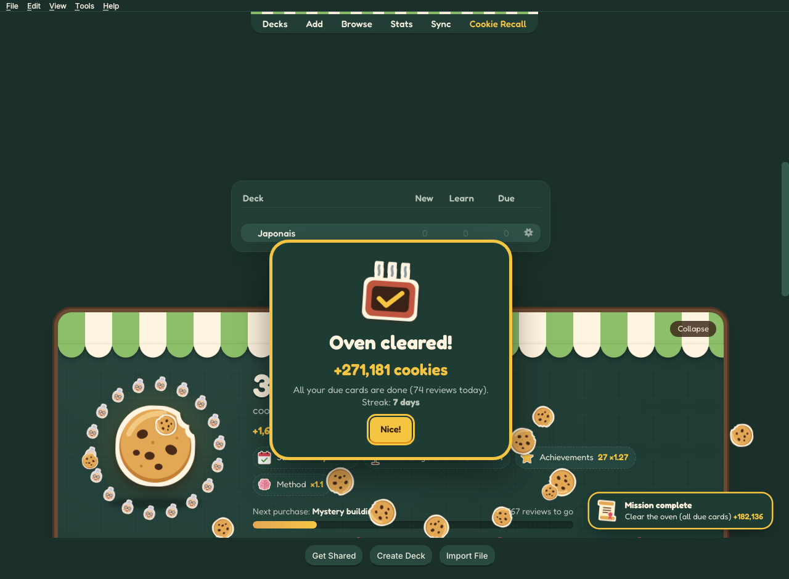
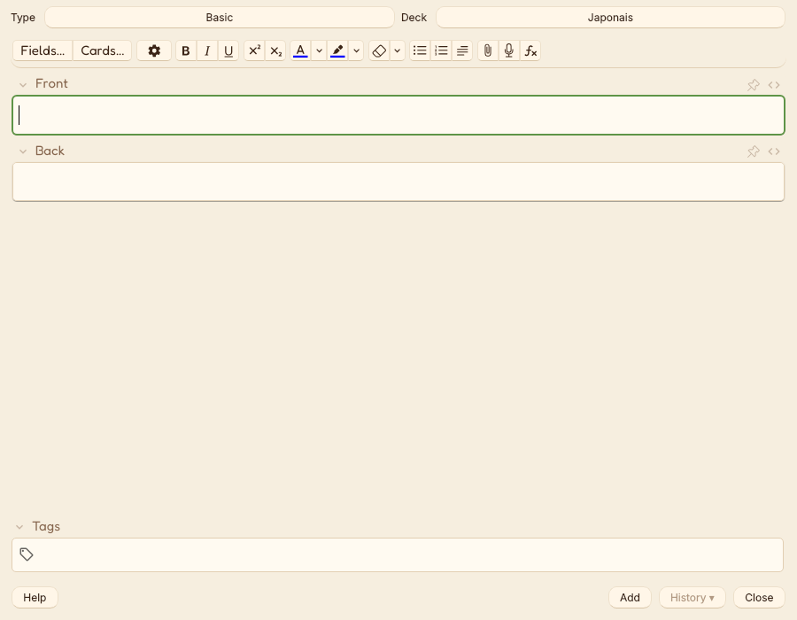
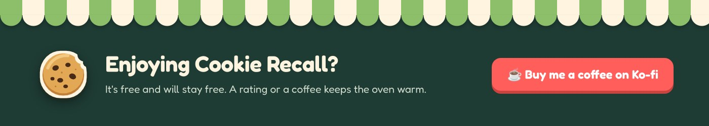

# Cookie Recall

**A Cookie Clicker for Anki where reviewing is the only way to bake.**
You can't click the cookie: every review bakes cookies. Buy Grannies, Wood ovens and Windmills all the way up to the Cosmic prism, and watch your bakery grow at the pace of your learning.

English & French · Anki Desktop 23.10+ (tested on 26.9) · light and dark mode · [Version française](README.fr.md)



## What you get

- **While reviewing**: a small counter in a corner, with "+N" on every answer, your combo, your next purchase and the golden cookie to catch.
- **On the deck list**: the full bakery, with the display shelves, the shop, daily missions, achievements, diplomas and stats.
- **On a deck's page**: a one-line strip showing your cookies.
- **One-click studying**: a "Study now" card above your decks (or press **S**) and a ▶ Study button on every deck row take you straight into reviews, no overview screen in between.
- **Better-looking cards**: plain cards become a paper card on a soft desk, with a nicer font and coloured answer buttons. Cards with their own custom styling are left exactly as they are.
- **5 colour palettes**: Pistachio, Raspberry, Blueberry, Chocolate and Lavender, for the bakery, the counter, the cards and the whole Anki theme (🎨 button on the awning).
- **Cookie Recall theme**: re-skins all of Anki in the same universe (top bar, deck list, Add cards, Browser, Statistics, Deck options, menus). It never touches your card content and can be turned off in one click.

| One-click study | Card style | Raspberry palette |
|---|---|---|
|  |  |  |
| **Blueberry, dark mode** | **Oven cleared jackpot** | **Theme: Add cards** |
|  |  |  |

## How the game works

**No passive income.** Buildings produce nothing on their own; they raise the value of each review. If you don't review, nothing moves, even with 500 Grannies.

```
gain = (3 + buildings) × upgrades × achievements × Knowledge × streak × diplomas × combo × frenzy × anti-farm
```

- **14 buildings** from the Granny (15 cookies) to the Cosmic prism. Each tier multiplies the payback by ~2.45, so the game opens fast and stretches over months.
- **~140 upgrades**: ×2 per building at 1, 5, 25, 50, 100, 150, 200 and 250 units, plus learning techniques (Active recall, Spacing effect…), combo, golden cookie, cat and Knowledge upgrades.
- **Combo**: each review chained without a break longer than 2 minutes adds +1% (capped, upgradeable). Consistency counts, never speed.
- **Golden cookie**: about one review in 40, at the edge of the screen, for 14 s: Lucky, a ×7 Frenzy or a cookie rain.
- **Clear the oven**: finish *all* your due cards for the day for a jackpot and +1 streak day.
- **Streak**: +3% per day (up to 30 days). A Protective frosting, bought with cookies, saves it if you miss a day.
- **Knowledge**: +1% per 25 mature cards (interval ≥ 21 days), the only bonus that measures what you've actually retained.
- **Daily missions**, **135 achievements** (some secret), and **Diplomas**, a prestige layer with a Legacy tree of 9 permanent bonuses.

### Built not to hurt your learning

- **Every answer earns the same.** "Again" earns as much as "Easy"; the engine never even sees the grade, so lying to the scheduler can't pay.
- Same card again on the same day: 50%, then 20% (this also covers undo + re-answer).
- Answers under 0.8 s: 20%, and they don't feed the combo.
- Beyond 50 new cards a day: 25% each. Preview mode: 25%.

All thresholds are configurable.

## Install

- **From AnkiWeb**: *Tools → Add-ons → Get Add-ons…* and paste the code shown on the add-on's AnkiWeb page.
- **From a file**: download [`cookierecall.ankiaddon`](release/cookierecall.ankiaddon?raw=1), then double-click it (or *Tools → Add-ons → Install from file…*). Restart Anki.

Your game is saved in your collection and syncs through AnkiWeb. Add-ons don't run on AnkiMobile or AnkiDroid, so mobile reviews don't bake cookies.

## Settings

In the bakery (*Stats* tab, or the 🎨 button) or *Tools → Add-ons → Cookie Recall → Config*: colour palette, card style, language, theme, sounds, review counter and its position, reduced motion, collapsed bakery, anti-farm thresholds.

## Development

```
cookierecall/
  __init__.py        loads the Anki integration only inside Anki
  game.py            game engine, pure Python (no Anki dependency)
  content.py         buildings, upgrades, achievements, Legacy, missions (French reference)
  i18n.py            English content and Python-side messages
  integration.py     Anki hooks, saving, pycmd bridge
  theme.py           theme for all of Anki (Qt + web pages + Svelte pages)
  palette.py         the 5 colour palettes, everything else derived from them
  web/cookierecall.js   UI (review counter, bakery, strip) in a closed Shadow DOM
  web/strings.js     UI strings, French and English
  web/*.css, img/, fonts/   styles, 37 SVG stickers, Fredoka (OFL)
tools/
  build.sh           builds dist/cookierecall.ankiaddon
  simulate.py        balance simulation (50 / 200 / 500 reviews a day over a year)
  make_assets.py     regenerates the SVG art
  render.py          renders a page with QtWebEngine (the engine Anki uses)
tests/test_game.py   engine unit tests
```

```
python3 -m unittest tests.test_game   # engine tests
python3 tools/simulate.py             # balance curves
./tools/build.sh                      # package for AnkiWeb
```

Design choices: only official `aqt.gui_hooks`; every hook is guarded so an add-on error can never block reviewing; state lives in `col.set_config` (a few KB, keeps the undo history, syncs); assets via `setWebExports` with no CDN; the UI runs in a closed Shadow DOM so card templates and the add-on can't break each other; Python is the single source of truth and validates every purchase; the theme swaps Anki's own colour tokens so Qt windows and web pages change together, with no inline scripts (the editor enforces a CSP).

## Support

Cookie Recall is free and will stay free. If you enjoy it:

- ⭐ **Rate it on AnkiWeb**: it's what helps other learners find it. You can also do it from the bakery's *Stats* tab.
- ☕ **[Buy me a coffee on Ko-fi](https://ko-fi.com/ankinovia)**.
- 🐞 **[Report a bug or suggest an idea](https://github.com/Hypernoviaa/cookie-recall/issues)**.

[](https://ko-fi.com/ankinovia)

## Credits

Fredoka font © The Fredoka Project Authors, SIL Open Font License 1.1.
